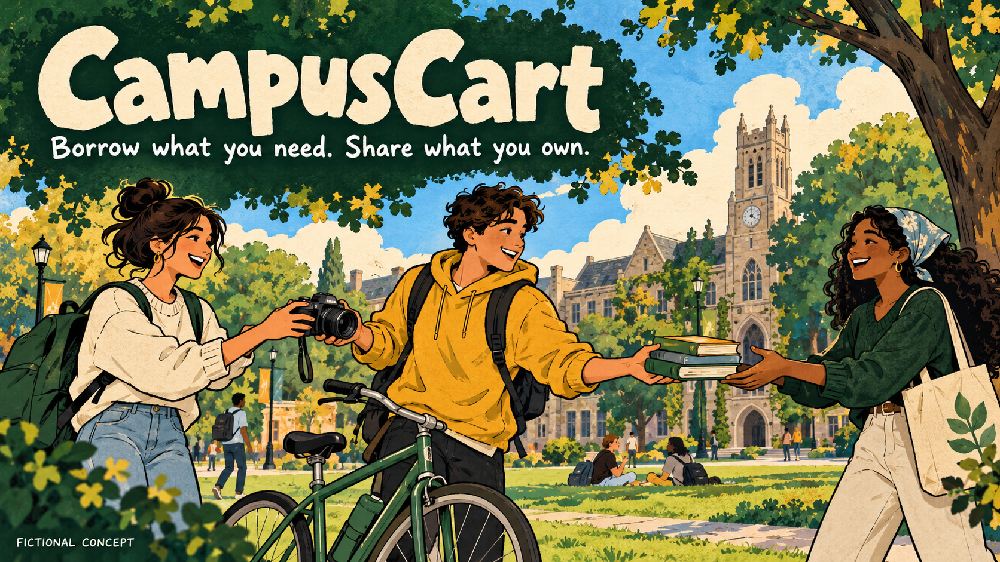
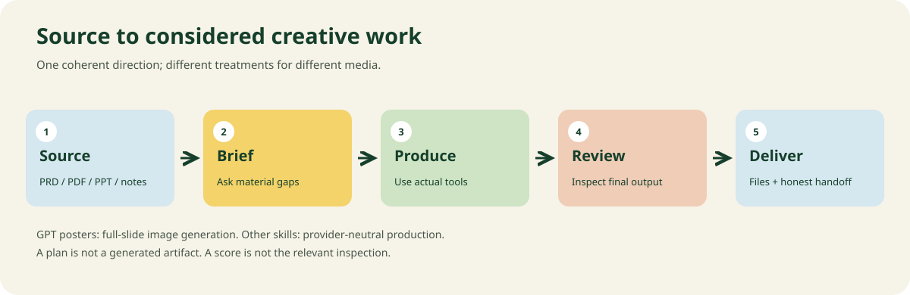

# Creative Studio Skills

**Turn a PRD, presentation, PDF, notes, or an unfinished idea into considered creative work.**

Universal production instructions for AI assistants, with a dedicated **GPT poster-slide workflow**. Presentations are generated as complete **16:9 illustrated poster images**, then packaged into a PDF or image-based PPTX. Other skills work with whatever suitable tools your AI has available.

This is a practical instruction library, not model-weight training or a promise that every AI has image, voice, browser, or file tools. The agent reads the relevant instructions and examples for the current task.

## Start here

| You want… | Read this skill |
|---|---|
| Several creatives from a PRD, vague idea, or mixed source files | [Creative director](skills/creative-director/SKILL.md) |
| A PPT/PDF of generated 16:9 slide posters | [GPT poster slides](skills/gpt-poster-slides/SKILL.md) **GPT-specific** |
| A poster, infographic, visual summary, or illustrated technical plate | [Posters and infographics](skills/poster-infographics/SKILL.md) |
| Illustrations, photos, textures, character art, or supporting visuals | [Visual assets](skills/visual-assets/SKILL.md) |
| A coherent identity, palette, typography, and asset system | [Brand identity](skills/brand-identity/SKILL.md) |
| A website or marketing front end | [Website front ends](skills/website-frontends/SKILL.md) |
| An app, dashboard, forms, onboarding, or product UI | [App interfaces](skills/app-interfaces/SKILL.md) |
| A designed PDF report, guide, proposal, or booklet | [Editorial PDF](skills/editorial-pdf/SKILL.md) |
| An editable Word report, memo, proposal, or form | [Word documents](skills/word-documents/SKILL.md) |
| A concise illustrated video with narration | [Explainer video](skills/explainer-video/SKILL.md) |
| Natural voiceover, pronunciation, and audio delivery | [Natural voiceover](skills/natural-voiceover/SKILL.md) |
| Clickable explanations, simulations, or branching video | [Interactive explainers](skills/interactive-explainers/SKILL.md) |
| Charts and an evidence-based visual data story | [Data storytelling](skills/data-storytelling/SKILL.md) |
| Coordinated posts, carousels, thumbnails, and ad concepts | [Social campaigns](skills/social-campaigns/SKILL.md) |
| Headlines, UX copy, narration, or creative editorial text | [Creative copy](skills/creative-copy/SKILL.md) |

Read [START_HERE.md](START_HERE.md) for the universal operating contract. Each skill has a concise entry point plus detailed local references, an intake guide, acceptance checks, and a worked example. **Read only what this task needs.**

## Use with GPT / ChatGPT for presentations

Give GPT this repository URL, your content, and this prompt:

```text
Use https://github.com/black1plague2/creative-studio-skills.
Read START_HERE.md, then skills/gpt-poster-slides/SKILL.md and its linked
references/gpt-workflow.md, references/art-direction.md, and
references/quality-and-export.md. Follow the worked example as a process,
not as content to copy.

Use the attached PRD / PDF / PPT / notes to create my presentation.
Generate every slide with GPT's available image-generation tool as a
complete landscape 16:9 illustrated poster. Use a coherent topic-specific
visual theme, exact verified content, and purposeful illustration. Include
designed architecture or user-flow infographics when they help explain it.

Ask only material questions the source does not answer: audience, purpose,
slide count, preferred visual direction, language, and requested output.
If I already specified something, do not ask again. Make reasonable,
explicit assumptions for reversible details.

Deliver the approved slide images, a 16:9 PDF, and an image-based PPTX
if file tools are available. Inspect the actual images and final exports.
If image generation or file tools are unavailable, explain the missing
capability and provide a clearly labeled prompt/production handoff.
Do not describe prompts or placeholders as finished slides.

My audience:
My objective:
My slide count, if fixed:
My language:
My visual preference or reference:
My required output:
```

Reading a public URL depends on the host's retrieval tools. If it cannot fetch the files, upload the relevant skill folder and its references, or paste them into the conversation. A single README is not a substitute for the task instructions. Keep original source files attached so the agent can verify the content.

**Poster generation:** GPT generates the entire finished slide, including typography and illustration. Do not silently substitute generic PowerPoint shapes or HTML screenshots for the requested GPT poster images. Keep exact slide text short enough to render reliably. Split dense content or regenerate defective text. The image-generation interface differs between hosts; inspect its actual controls rather than inventing tool arguments or assuming a particular image-model version.

## Use with Claude or another AI

```text
Use this repository as the creative production guide:
https://github.com/black1plague2/creative-studio-skills

Read START_HERE.md. Route my request to the relevant SKILL.md and read its
linked production, intake, quality, and example files. Use the actual
source material. Ask only material unanswered questions. Build, inspect,
repair, and deliver the artifact when your tools support it.

For a presentation, follow the GPT poster-slide contract. If you cannot
invoke GPT image generation, produce the complete GPT handoff package
and explain that poster generation remains to be done. Do not replace
that requirement without my agreement.

Task:
Input content:
Audience and purpose:
Outputs and constraints:
```

For hosts that support Agent Skills, install the selected skill folders in their documented skill directory. Copy the **whole folder**, including local references and helpers. [Claude Code](https://code.claude.com/docs/en/skills), [OpenAI skills](https://developers.openai.com/plugins/build/skills), and the [Agent Skills format](https://agentskills.io/specification) document their own discovery and invocation behavior. The plain Markdown workflow also works in conversations where the files are read explicitly.

No installer runs on download. No script uploads your content, obtains credentials, invokes a paid generation API, or publishes a project automatically.

## What “designed” means here



The example above is an **AI-generated original fictional concept**. Its prompt, source brief, reviewed images, and export records live in [examples/campuscart](examples/campuscart/README.md).

A coherent deck can be playful and sketch-like, culturally expressive, richly illustrated, or quietly editorial. Choose one direction for the subject and carry it through typography, palette, characters, image treatment, diagram vocabulary, and spacing. This library permits visually dense technical panels when that is what the audience needs. It does not impose a universal ban on cards, gradients, borders, serif fonts, or diagrams.

Generic decoration is not enough. A visual should explain the subject or establish a meaningful atmosphere. A hardware slide can show an illustrated mechanism; a user-flow slide can show people and actions; a data slide needs a faithful chart. Relevant source facts survive the transformation.



## Questions that improve the work

The agent first extracts what the source already establishes. It then asks a small batch of useful questions instead of giving the user a long intake form.

| Request | Usually material | Usually safe to infer |
|---|---|---|
| Poster-slide deck | Audience, purpose, fixed slide count, language, reference direction | Initial layout family, minor spacing, image filenames |
| Website/app | Primary task, target platform, actual functionality, existing stack/brand | Small token choices within an established system |
| PDF/Word | Intended use, document type, required content, print/editability needs | Initial hierarchy and page grid |
| Video | Runtime range, language/accent, audience, aspect ratio, narration route | Shot arrangement within the agreed story |
| Campaign | Platform, objective, real offer, audience, number of variants | Minor crop choices and internal naming |

If missing facts would change the message, functionality, rights to a required asset, or an irreversible action, ask. If a reversible design choice is missing, proceed with a stated assumption and make it reviewable. Do not ask questions already answered. Do not invent facts to avoid asking.

## Examples and illustrations

- [CampusCart PRD → generated poster images → PDF/PPTX](examples/campuscart/README.md)
- [Video script, storyboard, timing, captions, and motion source](examples/video/README.md)
- [Complete app-UI state example](examples/app-ui/README.md)
- [PDF/Word editorial treatment example](examples/documents/README.md)
- [Universal brief, source ledger, review record, and handoff](templates/README.md)
- [Illustrated production and quality guides](docs/illustrations/README.md)
- [Prompt recipes for common requests](docs/prompt-recipes.md)

Examples demonstrate a production pattern; they are not templates that every topic must resemble. Generated conceptual UI illustrations do not establish implemented product features. Example data is explicitly labeled illustrative.

## Helpers and validation

The GPT slide skill includes local Python helpers for checking 16:9 images, making a contact sheet, and packaging ordered images into an image-based PDF/PPTX. They do **not** generate the poster artwork.

```bash
python -m pip install -r skills/gpt-poster-slides/scripts/requirements.txt
python skills/gpt-poster-slides/scripts/validate_images.py examples/campuscart/slides
python skills/gpt-poster-slides/scripts/contact_sheet.py examples/campuscart/slides --output work/contact-sheet.jpg
python skills/gpt-poster-slides/scripts/package_slides.py examples/campuscart/deck.json --output-dir work/campuscart
```

Use a manifest for explicit slide order and exact copy. Wrong aspect ratios fail; the helpers never stretch a poster into 16:9. They preserve image order and refuse accidental overwrites unless `--overwrite` is passed. Packaging cannot verify spelling, scientific accuracy, tone, illustration consistency, or whether a slide communicates its point: an actual visual review is required.

Run repository checks with:

```bash
python -m pip install -r requirements-dev.txt
python scripts/validate_repo.py
python -m unittest discover -s tests -v
```

[VALIDATION.md](VALIDATION.md) states what was actually checked and what remains untested. A readable skill file is not proof of reliable generation across every AI model.

## Sources, ownership, and scope

The production rules are original synthesis informed by **58 surveyed repositories**, published creator workflows, and standards. [SOURCES.md](SOURCES.md) identifies the most relevant references; [research/sources.csv](research/sources.csv) records the broader survey and its limitations. Upstream implementations were not copied into this repo. Public research references are not automatically cleared for redistribution.

The instructions, original helpers, and original example assets in this repository are offered under [MIT](LICENSE), subject to the asset notes in [ASSET_PROVENANCE.md](ASSET_PROVENANCE.md). Third-party engines, voices, fonts, model weights, and supplied source content keep their own terms. Your source material is not automatically committed or published.

Start with a real brief, inspect the result, and improve a rule when a demonstrated failure justifies it. Keep the library detailed in its task references and inexpensive to load at its entry points.
