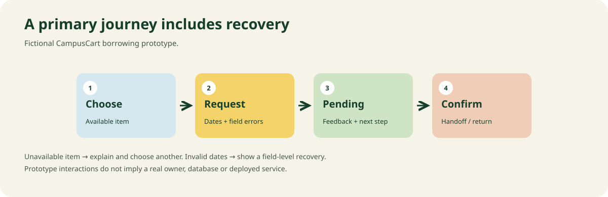

# App UI example: a complete borrowing request state flow

This original browser prototype shows relevant states from the app-interface skill. It is fictional CampusCart concept work with local demo data and **no server, real owner, account, payment or message delivery**.

Open [index.html](index.html) in a modern browser. It has no external dependencies or network calls. Select an item, set dates, send a local demo request, and reset. An unavailable item and invalid dates provide explicit recovery. A concept success message states what happened locally rather than pretending a real request was sent.

## Design decisions

- Preserve a campus identity through cream/forest surfaces and one marigold action accent.
- Use readable system typography for controls instead of forcing poster display lettering onto every label.
- Keep the selected item and the request form together; provide local errors beside their fields.
- Provide selected/unavailable/default, error, loading, and success states; visible keyboard focus and status text.
- Use structural mobile layout, clear labels, and a reset action.

## Expected verification

Exercise an invalid date range, an unavailable item, a valid local request and reset. Check keyboard operation, visible focus, labels, narrow layout and status feedback. The repo's validation record states which checks were actually run. This file is a runnable example, not evidence of a deployed product.
