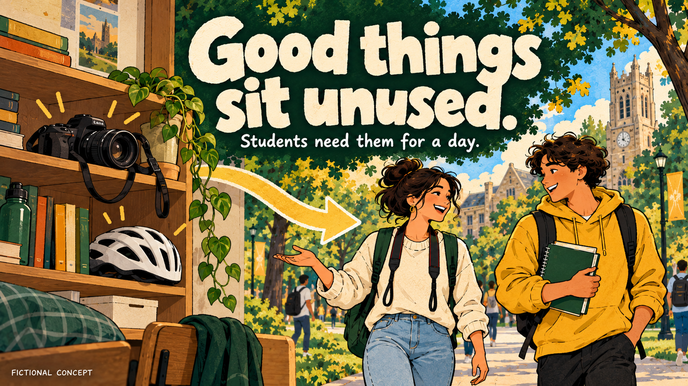
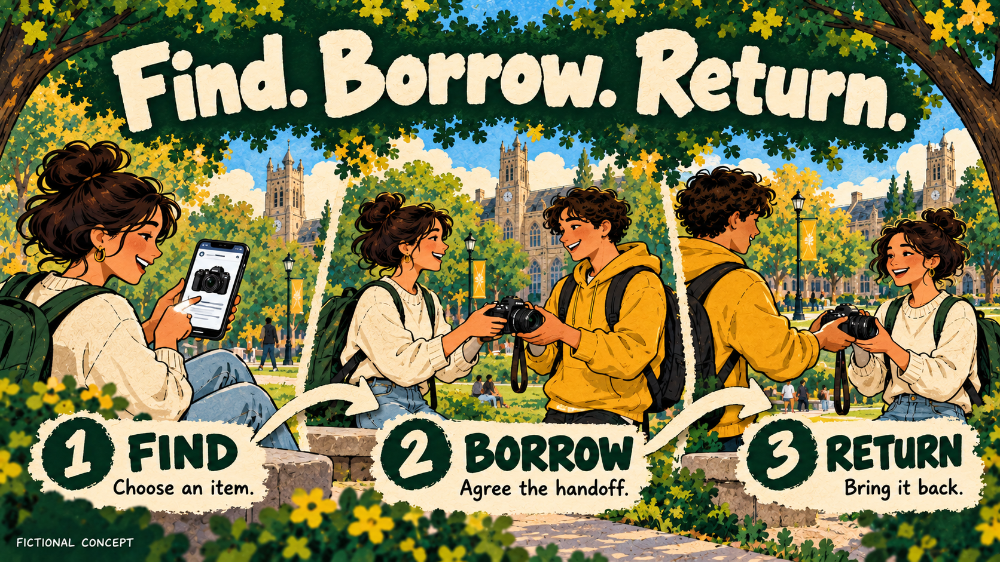

# CampusCart: PRD to GPT poster slides

An original fictional campus-borrowing concept demonstrates the GPT-specific slide workflow. These are **generated examples**, not a real launched app or evidence of human-made artwork.

## Reproduction record

1. Read [source PRD](source-prd.md) and [resolved brief](brief.md).
2. Preserve the exact text in [deck.json](deck.json).
3. Use [cover prompt](prompts/01-cover.md) to establish the identity.
4. Generate [problem](prompts/02-problem.md) and [workflow](prompts/03-workflow.md) as separate complete poster images, using the cover as a style/character reference.
5. Inspect the exact visible copy, stage direction, same-camera continuity, proportions and coherent palette. Review [QA notes](qa.md).
6. Validate and package using the GPT slide skill's local helpers. The packaging report distinguishes actual dimensions from exact 16:9 output pages.

The original built-in GPT image-generation route returned **1672×941** files, within one pixel of 16:9. They were not stretched, cropped or painted over. The PDF/PPTX containers are exact 16:9 and proportionately contain the complete images. A contract requiring exact 1920×1080 PNGs would still require a supported exact-canvas generation/export route.

The fictional campus setting, palette and characters are this example's direction. Other topics should establish their own identity. The three-slide count includes the cover; no unnecessary closing slide was added.

## Files

- [Three-slide PDF](exports/campuscart.pdf)
- [Image-based PowerPoint](exports/campuscart.pptx)
- [Exact-copy transcript](exports/campuscart-transcript.md)
- [Mechanical packaging report](exports/campuscart-packaging-report.json)
- [QA contact sheet](contact-sheet.jpg)

These files demonstrate a tested packaging path. They do not prove every GPT host exposes the same image tool or can produce the same illustration.
