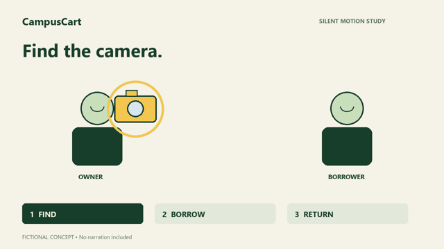

# Video example: the same object changes state

This original fictional CampusCart example includes a [spoken script](script.md), [storyboard/timing plan](storyboard.json), and [voice audition guide](voice-audition.md).



The [12-second MP4 motion study](motion-study.mp4) is **silent**, labeled, and intentionally limited. It demonstrates meaningful motion: the same camera is selected, borrowed, then returned. It is not a finished narrated product video and does not validate a natural voice. No paid speech/generation service was called.

The original [render source](render_motion_study.py) uses simple code-native illustration. It does not edit or animate the GPT poster images and is not a substitute for a fully illustrated production. The general video skill can use richer scene assets and any suitable editor/animation engine.

## Reproduce the motion study

```bash
python -m pip install -r examples/video/requirements.txt
python examples/video/render_motion_study.py --output-dir work/video-study
```

The renderer has no network calls and does not synthesize audio. The first run of an installed imageio-ffmpeg package may need its configured FFmpeg binary. It uses an available system font or Pillow fallback; no font binary is bundled.

## Live production continuation

Choose the language/accent/narrator with the user, generate/record an audition, listen, revise, and measure the voice. Replace estimated storyboard spans with spoken anchors and actual duration. Build a representative styled scene, then produce the full film with captions. Verify complete audio/picture playback and final export.

The source script's runtime is a planning estimate, not a measured voice performance. A host without direct listening must explicitly leave the naturalness review unrun.
